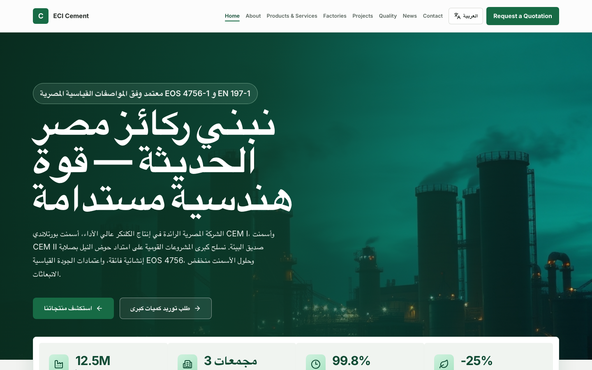
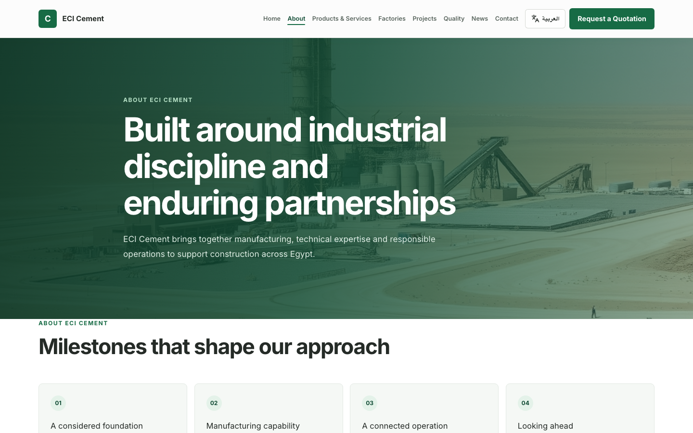
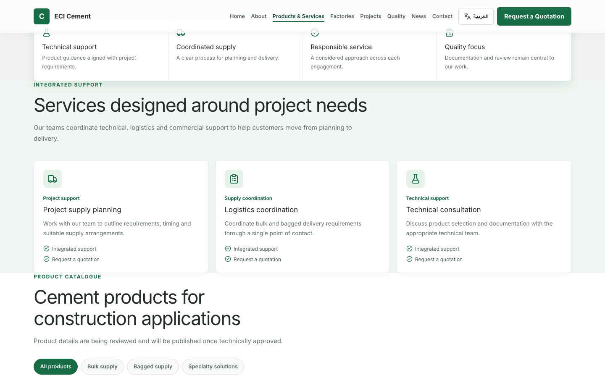
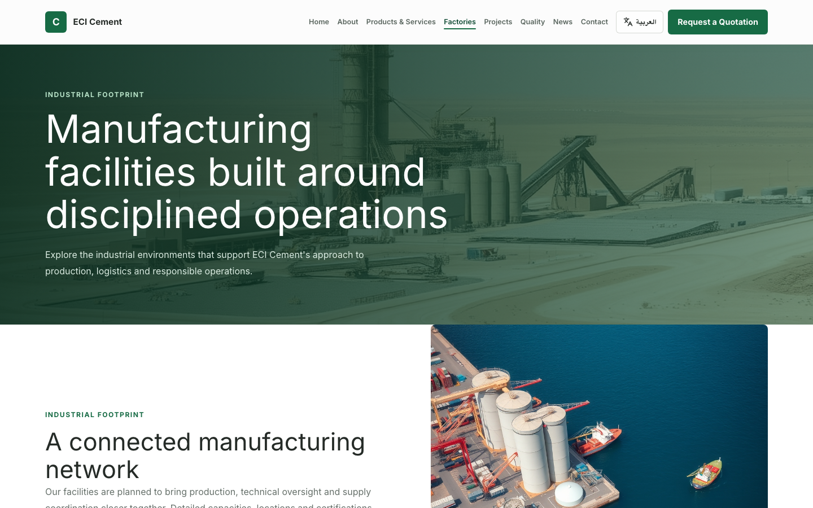
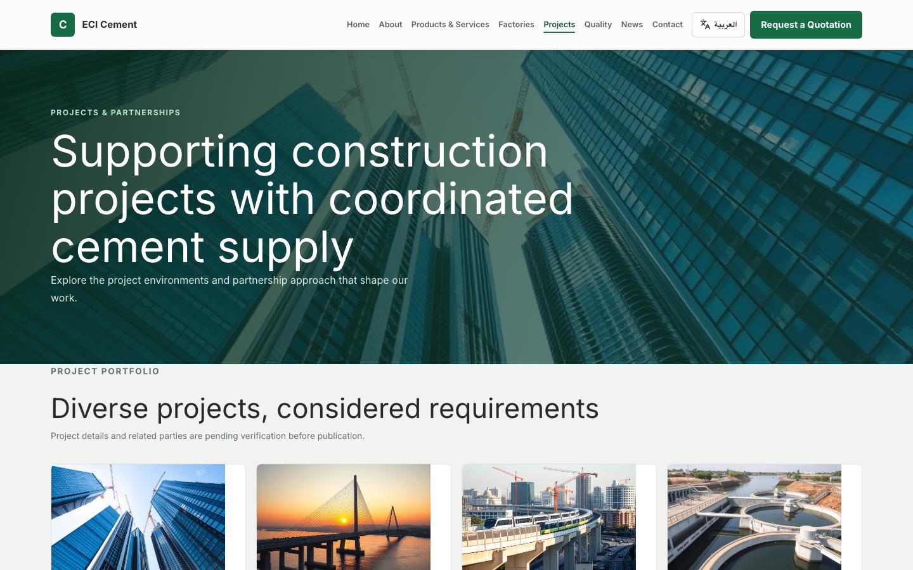
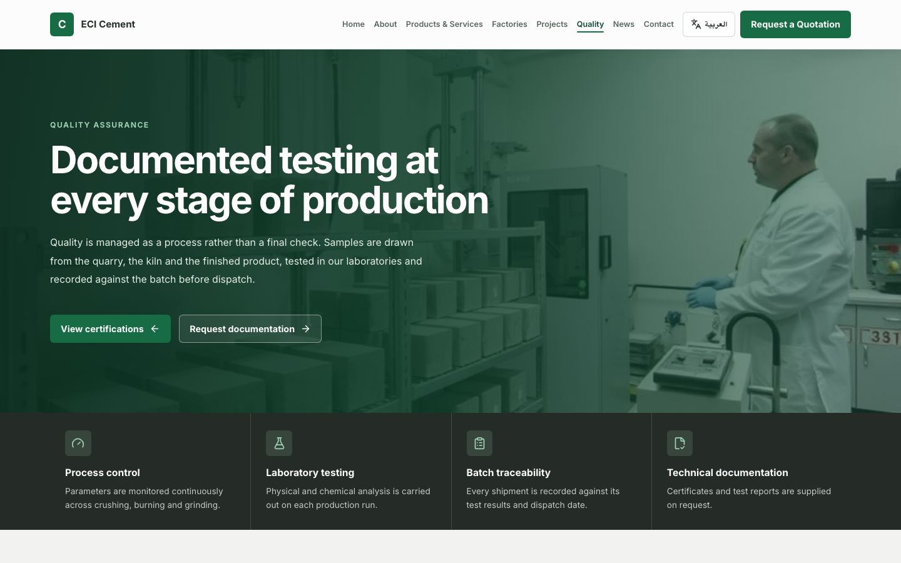

# ECI Website

[](https://eci-website.zaid-kreshati.workers.dev/)

Live site: https://eci-website.zaid-kreshati.workers.dev/

Initial frontend foundation for a corporate cement manufacturing website.

## Getting started

```sh
npm install
npm run dev
```

## Available scripts

- `npm run dev` — start the Vite development server.
- `npm run build` — type-check and create a production build in `dist/`.
- `npm run preview` — preview the production build locally.

## Technology

- React and TypeScript for the component-based application.
- Vite for development and production bundling.
- Tailwind CSS v4 through its official Vite plugin.
- React Router DOM for client-side routes.
- Lucide React for interface icons.

## Project structure

```text
src/
  components/
    common/           Shared small UI components
    layout/           Site header and footer
  i18n/               English/Arabic strings and language state
  layouts/            Shared route layout
  pages/              Route-level page placeholders
  routes/             React Router configuration
  styles/             Global reset and base styling
  types/              Shared TypeScript types
  App.tsx             Application providers and router
  main.tsx            Browser entry point
```

The page routes are structural placeholders; full page designs and company-specific content have not been added.

## Screenshots

Captured from the [live website](https://eci-website.zaid-kreshati.workers.dev/).

| About | Products & Services | Factories |
| --- | --- | --- |
|  |  |  |
| **Projects** | **Quality** | |
|  |  | |
